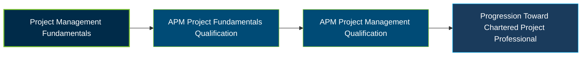

# APM Project Management Qualification Certification Exam Guide

A dedicated study guide and knowledge reference for candidates preparing for the **APM Project Management Qualification (PMQ)**, covering the principles, competencies, and practices required to manage projects effectively across different environments.

---

## Exam Overview

The APM Project Management Qualification validates broad project management knowledge and understanding, including how project activities interact and contribute to organisational strategy and successful delivery.

- **Exam Format**: Online examination through the Surpass platform, including multiple-response, select-from-list, short-response, and long-response questions.
- **Target Audience**: Project professionals, typically with two to three years of experience, and learners undertaking a project management apprenticeship or degree.
- **Prerequisites**: No mandatory prior experience or qualifications; relevant project management knowledge or experience is recommended.

---

## Core Exam Domains & Knowledge Areas

### 1. Setting Up for Success

- Understand linear, iterative, and hybrid life cycles, governance arrangements, and organisational structures.
- Apply sustainability principles and understand business cases, strategic alignment, benefits, costs, and risks.
- Understand project roles, accountability, sponsorship, and the factors influencing project success.

### 2. Preparing for Change

- Understand procurement strategies, supplier selection, contractual relationships, and reimbursement methods.
- Apply project reviews, decision gates, audits, assurance, and performance reporting.
- Understand transition management, knowledge transfer, and benefits identification, planning, tracking, and realisation.

### 3. People and Behaviours

- Understand stakeholder analysis, engagement, communication planning, and expectation management.
- Apply conflict resolution approaches and understand negotiation and communication methods.
- Understand leadership, team management, diversity and inclusion, ethics, compliance, and professional development.

### 4. Planning and Managing Deployment

- Understand requirements management, scope definition, configuration management, and solution development.
- Apply quality management, integrated planning, scheduling, resource management, and cost control.
- Understand risk and issue management, contingency planning, change control, and project monitoring.

---

## Certification Path

---

## Recommended Practice & Study Resources

Use official APM materials as the foundation for PMQ exam preparation, supported by focused revision and practical project management exercises.

- **CertsGate**: Explore [APM PMQ certification preparation resources](https://certsgate.com/exams/apm/apm-pmq) for supplementary study materials and practice to reinforce project management knowledge.
- **Practical Study Resource**: Use the [APM Competence Framework](https://www.apm.org.uk/resources/find-a-resource/competence-framework/) and [APM Body of Knowledge](https://www.apm.org.uk/book-shop/apm-body-of-knowledge-7th-edition/) to explore project management competencies and apply them to practical project scenarios.
